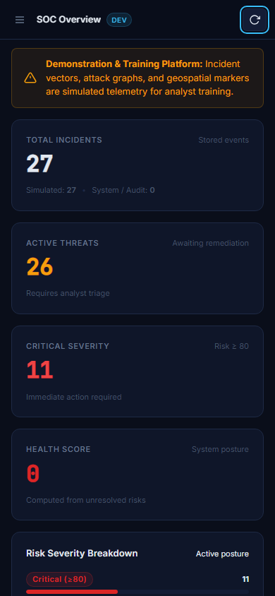

# AuthGuard-X — Security Operations Center (SOC) Simulation & Hardening Platform

[](https://github.com/Mannan55/AuthGuard-X/actions/workflows/ci.yml)
[](https://www.python.org/downloads/)
[](https://flask.palletsprojects.com/)
[](LICENSE)

AuthGuard-X is a professional Security Operations Center (SOC) demonstration, training, and incident triage platform designed for cybersecurity analysts, educators, and developers. It models an identity security monitoring system that detects, visualizes, and remediates suspicious authentication telemetry, credential attacks, and anomalous behavior.

> **Simulation Disclosure:** All attack vectors, threat geographic coordinates, and simulated incident streams are generated locally for training and demonstration purposes. AuthGuard-X does not claim to provide unverified live external threat intelligence or enterprise SIEM capabilities.

---

## Visual Demonstration (Sprint 1 Redesign)

| 1. Authentication Portal | 2. Operational SOC Overview |
|:---:|:---:|
|  |  |
| *Session-based login with dev credential guidance* | *Live KPI cards, severity distribution & threat timeline* |

| 3. Advanced Incident Management Table | 4. Incident Detail Triage Modal |
|:---:|:---:|
|  |  |
| *Search, severity/status/source filters & pagination* | *Full audit metadata and one-click remediation* |

<div align="center">
  
  <p><em>Responsive mobile analyst layout with collapsible navigation</em></p>
</div>

---

## Cybersecurity & SOC Use Cases

1. **Analyst Triage Training**: Train junior security analysts in evaluating incoming authentication anomalies, differentiating between low-priority alerts and high-risk credential-stuffing attacks.
2. **Incident Lifecycle Remediation**: Experience end-to-end incident management: identification, risk scoring, status progression (`OPEN` to `RESOLVED`), and health metric recovery.
3. **Attack Vector Simulation**: Inject controlled simulated telemetry (e.g., high-velocity brute force, automated bot stuffing, geographic velocity anomalies) to observe dashboard telemetry impacts.
4. **Defensive Hardening Reference**: Learn secure Flask architecture practices: cryptographic password hashing, server-verified sessions, CSRF protection, role-based access control (RBAC), XSS prevention, and strict origin controls.

---

## Architecture Overview

```
                      +---------------------------------------+
                      |       Web Browser (Frontend)         |
                      |  - Modular HTML5 / Vanilla JS (ES6+)  |
                      |  - Design Tokens & 8px Spacing Grid   |
                      |  - Chart.js Telemetry Graph           |
                      |  - XSS-Safe DOM Sanitization          |
                      +-------------------+-------------------+
                                          |
                        HTTP / JSON (REST)| Session Cookies + CSRF Token
                       SameSite=Lax       | HttpOnly + X-CSRFToken
                                          v
                      +-------------------+-------------------+
                      |      Flask Application Server         |
                      |  - Session Auth & RBAC Middleware     |
                      |  - Flask-WTF CSRF Token Verification  |
                      |  - Rate Limiting (Flask-Limiter)      |
                      |  - Query Search, Filter, Sort, Pages  |
                      |  - Server-Derived Aggregated Metrics  |
                      |  - Safe Geolocation (Offline-First)   |
                      |  - Security Error Handlers            |
                      +-------------------+-------------------+
                                          |
                                          v
                      +-------------------+-------------------+
                      |       Persistence Engine              |
                      |  - SQLite (authguard.db)              |
                      |  - Users (bcrypt password hashes)     |
                      |  - Incidents (Telemetry & Simulation) |
                      +---------------------------------------+
```

---

## Technology Stack

- **Backend Framework**: Python 3.11+ / Flask 3.1
- **Security & Crypto**: `bcrypt` (adaptive blowfish hashing, 12 rounds), `secrets` (CSPRNG session keys)
- **CSRF & Form Defense**: `Flask-WTF` CSRF protection with `/api/auth/csrf-token` endpoint
- **Session & CORS Management**: Flask Session (`HttpOnly`, `SameSite=Lax`, `Secure` in production), `Flask-Cors` (restricted origin whitelist with credential support)
- **Traffic Protection**: `Flask-Limiter` (IP-based endpoint rate throttling)
- **Frontend Architecture**: Modular Vanilla JavaScript (ES6+), design tokens (`tokens.css`), responsive layout (`layout.css`), accessible components (`components.css`), Chart.js
- **Database**: SQLite3 with connection pooling and schema migration guards
- **Testing**: `pytest` test suite with 60 comprehensive automated tests

---

## Security Model & Hardening

| Vulnerability Addressed | Previous Vulnerable State | Hardened Implementation |
|---|---|---|
| **Credentials** | Hardcoded `admin` / `admin123` in source | Hashed with bcrypt (12 rounds). Managed via `.env`. Provisioned exclusively in `development` mode; disabled in `production`. |
| **Authentication** | Dummy client-side check, no session | Server-signed session cookies (`HttpOnly`, `SameSite=Lax`). Protection against session fixation and replay. |
| **CSRF Protection** | Missing on mutating requests | `Flask-WTF` CSRF token verification across all state-changing endpoints with pre-flight token issuance. |
| **Access Control** | Open unauthenticated API access | Protected via `@login_required` and `@admin_required` decorators across all incident and resolution routes. |
| **Simulation Provenance** | Client could claim simulated as live | Server strictly enforces `is_simulated = 1` on all simulation ingestion routes. |
| **Cross-Site Scripting (XSS)** | Raw `innerHTML` template interpolation | Strict HTML escaping helper (`escapeHTML`) and safe DOM manipulation for all dynamic attack log feeds. |
| **CORS Policy** | Unrestricted wildcard (`*`) | Strict origin whitelist configurable via `CORS_ALLOWED_ORIGINS`. |
| **IP Privacy** | Plaintext HTTP IP leak to `http://ip-api.com` | Offline internal/loopback resolution. External GeoIP disabled by default; HTTPS enforced if enabled. |
| **DoS / Brute Force** | Unlimited rapid requests permitted | Rate limiting applied (`RATE_LIMIT_LOGIN`, `RATE_LIMIT_SIMULATE`). Input boundary and type validation. |

---

## Quickstart & Execution Guide

### Prerequisites
- Python 3.11 or later installed.
- Git.

### 1. Clone & Set Up Environment

```powershell
# Clone the repository
git clone https://github.com/Mannan55/AuthGuard-X.git
cd AuthGuard-X

# Create and activate a virtual environment (optional but recommended)
python -m venv venv
.\venv\Scripts\Activate.ps1    # On Windows
# source venv/bin/activate     # On Linux / macOS

# Install dependencies
pip install -r backend/requirements.txt
```

### 2. Configure Environment Variables

Copy the provided `.env.example` file:

```powershell
# On Windows
copy .env.example .env

# On Linux / macOS
cp .env.example .env
```

Key environment configuration variables:

```ini
AUTHGUARD_ENV=development
HOST=127.0.0.1
PORT=5000
SECRET_KEY=your-cryptographic-secret-key-32bytes
DEMO_MODE=true
SEED_DEMO_USER=true
DEMO_ADMIN_USER=admin
DEMO_ADMIN_PASSWORD=DemoAdminPassword2026!
CORS_ALLOWED_ORIGINS=http://127.0.0.1:5000,http://localhost:5000
ENABLE_EXTERNAL_GEOIP=false
```

### 3. Run the Application

```powershell
python backend/app.py
```

Open your browser to:
**[http://127.0.0.1:5000](http://127.0.0.1:5000)**

In development mode (`AUTHGUARD_ENV=development`), the default demo analyst account (`admin` / `DemoAdminPassword2026!`) is automatically provisioned for immediate evaluation.

---

## Automated Verification & Testing

The project includes an automated test suite verifying security controls, access control rules, XSS sanitization, session expiration, and persistence across restarts.

```powershell
# Run the complete test suite (60 tests)
pytest tests -v
```

### Test Coverage Highlights
- **Phase 1 Baseline** (`tests/test_auth_guard.py`): 15 tests covering health checks, login validation, session state, unauthenticated access blocking, and persistence.
- **Sprint 1 Upgrades** (`tests/test_sprint1.py`): 45 tests covering:
  - CSRF token endpoint and validation.
  - Strict simulation provenance enforcement.
  - Server-side derived metrics endpoint and health score bounds.
  - Paginated incident response envelope (`page`, `per_page`, `total`, `total_pages`).
  - Search across attack, username, and behavior fields.
  - Severity, status, and source query filters.
  - Safe column sorting against allowlists (SQL injection resistant).
  - Incident detail retrieval and 404 handling.
  - XSS resilience with hostile payload strings.

---

## Limitations & Roadmap (Sprint 2)

- **Single Host Storage**: Currently persists to single-node SQLite suitable for local labs and training. High-concurrency clustering with PostgreSQL is planned for Sprint 2.
- **Simulated Geographic Visualization**: Attack map markers are generated based on simulated vector coordinates rather than live GPS telemetry.
- **Multi-Factor Authentication**: Single-factor password verification is enforced; MFA (TOTP / WebAuthn) will be integrated in Sprint 2.
- **Rules Engine**: Risk scoring utilizes deterministic heuristics. An adaptive anomaly detection rules engine is scheduled for future sprints.

---

## License

Distributed under the MIT License. See `LICENSE` for more information.
