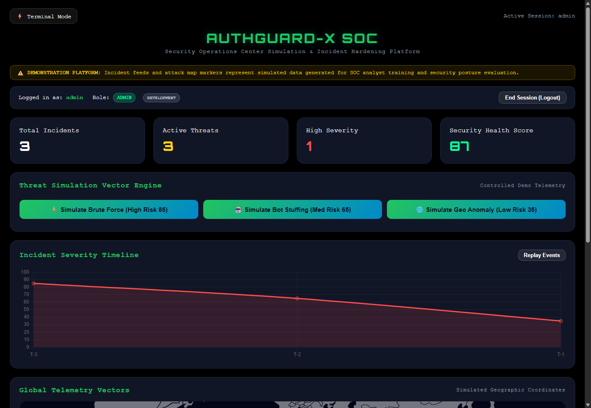
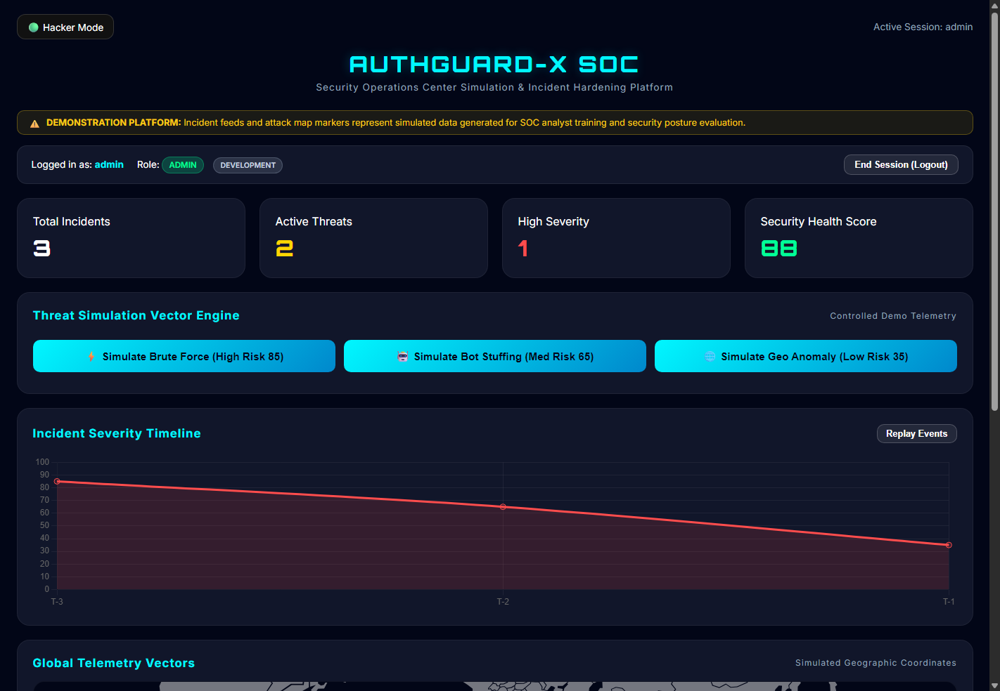

# AuthGuard-X : Security Operations Center (SOC) Simulation & Hardening Platform

[](https://github.com/Mannan55/AuthGuard-X/actions/workflows/ci.yml)
[](https://www.python.org/downloads/)
[](https://flask.palletsprojects.com/)
[](LICENSE)

AuthGuard-X is an interactive Security Operations Center (SOC) demonstration and incident triage platform designed for security analysts, educators, and developers. It models an identity security monitoring system that detects, visualizes, and remediates suspicious authentication telemetry, credential attacks, and anomalous behavior.

> **Simulation Disclosure:** All attack vectors, threat geographic coordinates, and simulated incident streams are generated locally for training and demonstration purposes. AuthGuard-X does not claim to provide unverified live external threat intelligence or enterprise SIEM capabilities.

---

## Visual Demonstration

| 1. Authenticated Session Gate | 2. Operational SOC Dashboard |
|:---:|:---:|
|  |  |
| *Session-based login with dev credential guidance* | *Real-time metrics, simulation vectors & timeline* |

| 3. High-Contrast Terminal Mode ("Hacker Mode") | 4. Incident Remediation & Resolution |
|:---:|:---:|
|  |  |
| *Monochrome CRT-style SOC theme toggle* | *Audited incident mitigation workflow* |

---

## Cybersecurity & SOC Use Cases

1. **Analyst Triage Training**: Train junior security analysts in evaluating incoming authentication anomalies, differentiating between low-priority alerts and high-risk credential-stuffing attacks.
2. **Incident Lifecycle Remediation**: Experience end-to-end incident management: identification, risk scoring, status progression (`OPEN` to `RESOLVED`), and health metric recovery.
3. **Attack Vector Simulation**: Inject controlled simulated telemetry (e.g., high-velocity brute force, automated bot stuffing, geographic velocity anomalies) to observe dashboard telemetry impacts.
4. **Defensive Hardening Reference**: Learn secure Flask architecture practices: cryptographic password hashing, server-verified sessions, role-based access control (RBAC), XSS prevention, and strict origin controls.

---

## Architecture Overview

```
                      +---------------------------------------+
                      |       Web Browser (Frontend)         |
                      |  - HTML5 / CSS3 / Vanilla JS ES6      |
                      |  - Chart.js Telemetry Graph           |
                      |  - XSS-Safe DOM Sanitization          |
                      +-------------------+-------------------+
                                          |
                        HTTP / JSON (REST)| Session Cookies
                       SameSite=Lax       | HttpOnly
                                          v
                      +-------------------+-------------------+
                      |      Flask Application Server         |
                      |  - Session Auth & RBAC Middleware     |
                      |  - Rate Limiting (Flask-Limiter)      |
                      |  - Safe Geolocation (Offline-First)   |
                      |  - Security Error Handlers            |
                      +-------------------+-------------------+
                                          |
                                          v
                      +-------------------+-------------------+
                      |       Persistence Engine              |
                      |  - SQLite (authguard.db)              |
                      |  - Users (bcrypt password hashes)     |
                      |  - Incidents (Telemetry & Simulation) |
                      +---------------------------------------+
```

---

## Technology Stack

- **Backend Framework**: Python 3.11+ / Flask 3.1
- **Security & Crypto**: `bcrypt` (adaptive blowfish hashing, 12 rounds), `secrets` (CSPRNG session keys)
- **Session & CORS Management**: Flask Session (`HttpOnly`, `SameSite=Lax`, `Secure` in production), `Flask-Cors` (restricted origin whitelist with credential support)
- **Traffic Protection**: `Flask-Limiter` (IP-based endpoint rate throttling)
- **Frontend**: Vanilla JavaScript (ES6+), HTML5, CSS custom properties, Chart.js for telemetry curves
- **Database**: SQLite3 with connection pooling and schema migration guards
- **Testing**: `pytest` test suite with isolated in-memory and temporary database fixtures

---

## Security Model & Hardening (Phase 1)

| Vulnerability Addressed | Previous Vulnerable State | Hardened Implementation |
|---|---|---|
| **Credentials** | Hardcoded `admin` / `admin123` in source | Hashed with bcrypt (12 rounds). Managed via `.env`. Provisioned exclusively in `development` mode; disabled in `production`. |
| **Authentication** | Dummy client-side check, no session | Server-signed session cookies (`HttpOnly`, `SameSite=Lax`). Protection against session fixation and replay. |
| **Access Control** | Open unauthenticated API access | Protected via `@login_required` and `@admin_required` decorators across all incident and resolution routes. |
| **Cross-Site Scripting (XSS)** | Raw `innerHTML` template interpolation | Strict HTML escaping helper (`escapeHTML`) and safe DOM manipulation for all dynamic attack log feeds. |
| **CORS Policy** | Unrestricted wildcard (`*`) | Strict origin whitelist configurable via `CORS_ALLOWED_ORIGINS`. |
| **IP Privacy** | Plaintext HTTP IP leak to `http://ip-api.com` | Offline internal/loopback resolution. External GeoIP disabled by default; HTTPS enforced if enabled. |
| **DoS / Brute Force** | Unlimited rapid requests permitted | Rate limiting applied (`RATE_LIMIT_LOGIN`, `RATE_LIMIT_SIMULATE`). Input boundary and type validation. |

---

## Quickstart & Execution Guide

### Prerequisites
- Python 3.11 or later installed.
- Git.

### 1. Clone & Set Up Environment

```powershell
# Clone the repository
git clone https://github.com/Mannan55/AuthGuard-X.git
cd AuthGuard-X

# Create and activate a virtual environment (optional but recommended)
python -m venv venv
.\venv\Scripts\Activate.ps1    # On Windows
# source venv/bin/activate     # On Linux / macOS

# Install dependencies
pip install -r backend/requirements.txt
```

### 2. Configure Environment Variables

Copy the provided `.env.example` file:

```powershell
# On Windows
copy .env.example .env

# On Linux / macOS
cp .env.example .env
```

Key environment configuration variables:

```ini
AUTHGUARD_ENV=development
HOST=127.0.0.1
PORT=5000
SECRET_KEY=your-cryptographic-secret-key-32bytes
DEMO_MODE=true
SEED_DEMO_USER=true
DEMO_ADMIN_USER=admin
DEMO_ADMIN_PASSWORD=DemoAdminPassword2026!
CORS_ALLOWED_ORIGINS=http://127.0.0.1:5000,http://localhost:5000
ENABLE_EXTERNAL_GEOIP=false
```

### 3. Run the Application

```powershell
python backend/app.py
```

Open your browser to:
**[http://127.0.0.1:5000](http://127.0.0.1:5000)**

In development mode (`AUTHGUARD_ENV=development`), the default demo analyst account (`admin` / `DemoAdminPassword2026!`) is automatically provisioned for immediate evaluation.

---

## Automated Verification & Testing

The project includes an automated test suite verifying security controls, access control rules, XSS sanitization, session expiration, and persistence across restarts.

```powershell
# Run the complete test suite
pytest tests -v
```

### Test Coverage Highlights
- `test_health_check`: Verifies API operational status and configuration exposure.
- `test_index_serves_frontend`: Verifies single-origin static bundle delivery.
- `test_login_valid` & `test_login_invalid`: Verifies credential verification and bcrypt matching.
- `test_access_without_auth_blocked`: Confirms unauthenticated requests receive `401 Unauthorized`.
- `test_session_status_and_logout`: Confirms session invalidation and cookie clearing.
- `test_attack_simulation_and_incident_logging`: Verifies simulated incident tagging and risk calculations.
- `test_incident_resolution`: Ensures incidents transition from active to resolved.
- `test_legacy_endpoint_aliases`: Validates backwards compatibility for existing endpoint routes.
- `test_input_validation`: Verifies rejection of invalid risk ranges and corrupted payloads.
- `test_xss_resistance`: Validates handling of `<script>` and `` injection payloads.
- `test_database_persistence_across_restarts`: Confirms incidents persist in SQLite across server instances.
- `test_production_mode_disables_demo_user`: Enforces that demo credentials cannot be seeded in production.

---

## Limitations & Roadmap (Phase 2)

- **Single Host Storage**: Currently persists to single-node SQLite suitable for local labs and training. High-concurrency clustering with PostgreSQL is planned for Phase 2.
- **Simulated Geographic Visualization**: Attack map markers are generated based on simulated vector coordinates rather than live GPS telemetry.
- **Single-Factor Authentication**: Authentication currently relies on secure password verification; MFA/TOTP integration is scheduled for Phase 2.
- **Rule Engine**: Risk scoring utilizes deterministic heuristics. An advanced adaptive behavioral rules engine is planned for future phases.

---

## License

Distributed under the MIT License. See `LICENSE` for more information.
