# AuthGuard-X — Security Operations Center (SOC) Simulation & Hardening Platform

[](https://github.com/Mannan55/AuthGuard-X/actions/workflows/ci.yml)
[](https://www.python.org/downloads/)
[](https://flask.palletsprojects.com/)
[](LICENSE)

AuthGuard-X is a professional Security Operations Center (SOC) demonstration, training, detection engineering, and incident investigation platform designed for cybersecurity analysts, educators, and incident response teams. It models an identity security monitoring system that detects, correlates, visualizes, investigates, and remediates suspicious authentication telemetry, credential attacks, and anomalous behavior.

> **Simulation & Telemetry Provenance Disclosure:** All attack vectors, simulated incident streams, and geographic origins are generated locally for training and demonstration purposes with server-enforced provenance (`is_simulated = 1`). AuthGuard-X does not execute live exploits or claim unverified external threat feeds.

---

## Visual Demonstration & SOC Workspace (Sprint 2)

| 1. Authentication Portal | 2. Operational SOC Overview |
|:---:|:---:|
| 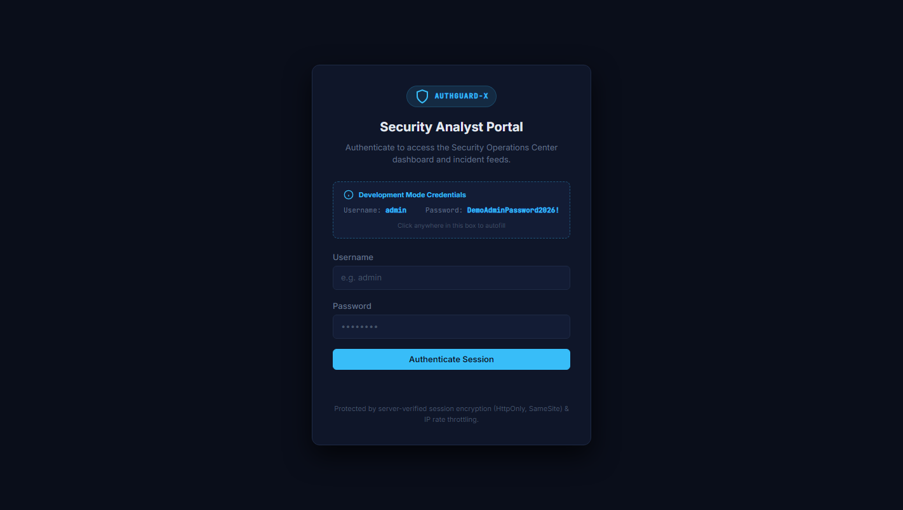 | 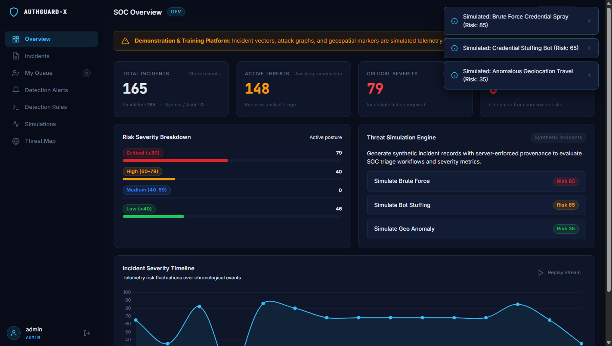 |
| *Session-based login with dev credential guidance* | *Live KPI cards, dynamic health score & threat timeline* |

| 3. Advanced Incident Management Table | 4. Incident Detail Triage Modal |
|:---:|:---:|
| 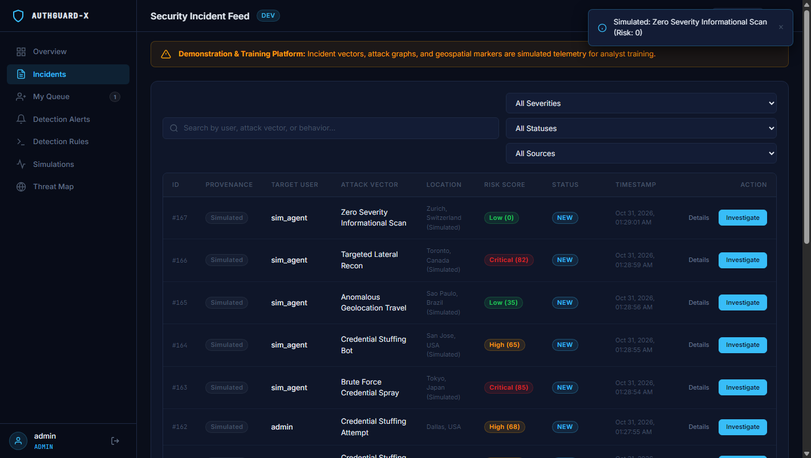 | 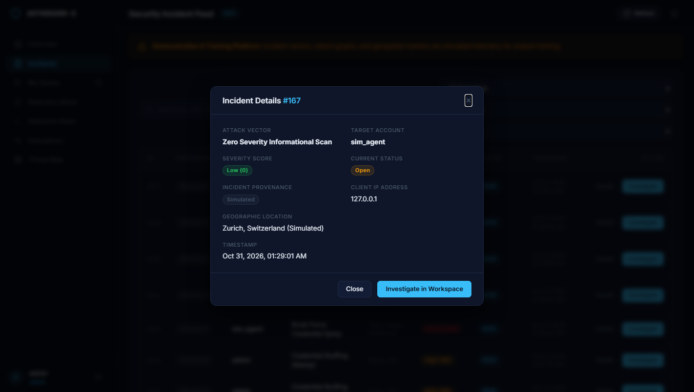 |
| *Search by ID/text, severity/status/source filters & pagination* | *Audit metadata, one-click remediation & investigation routing* |

| 5. Attack Simulation Lab | 6. Analyst Incident Work Queue |
|:---:|:---:|
| 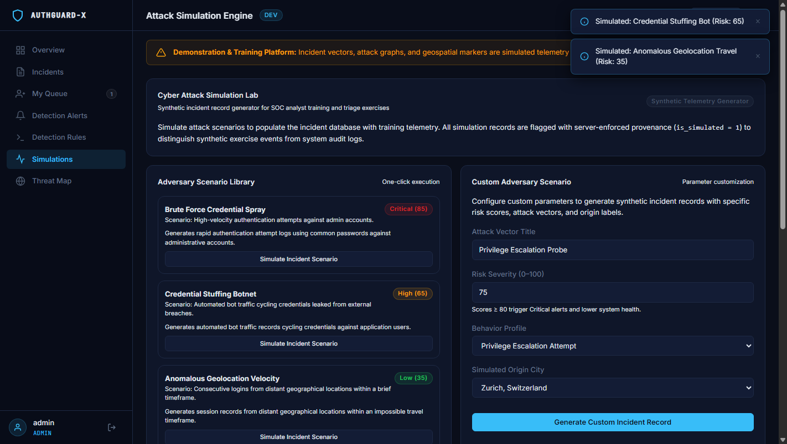 | 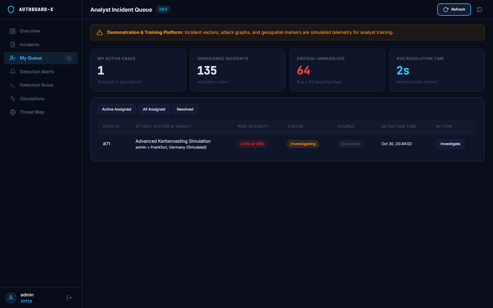 |
| *Controlled synthetic vector injection with city/risk targeting* | *Queue isolation, active triage filters & real-time KPI metrics* |

| 7. Investigation Workspace & Lifecycle Stepper | 8. Evidence Metadata & Audit Timeline |
|:---:|:---:|
| 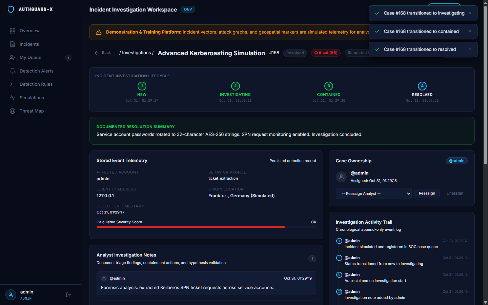 |  |
| *State machine progression (`New` → `Investigating` → `Contained` → `Resolved`)* | *Sanitized notes, IOC/pcap evidence pointers & append-only activity audit trail* |

| 9. Detection Alerts Feed & Threat Correlation | 10. Detection Rules Catalog & MITRE Mapping |
|:---:|:---:|
| 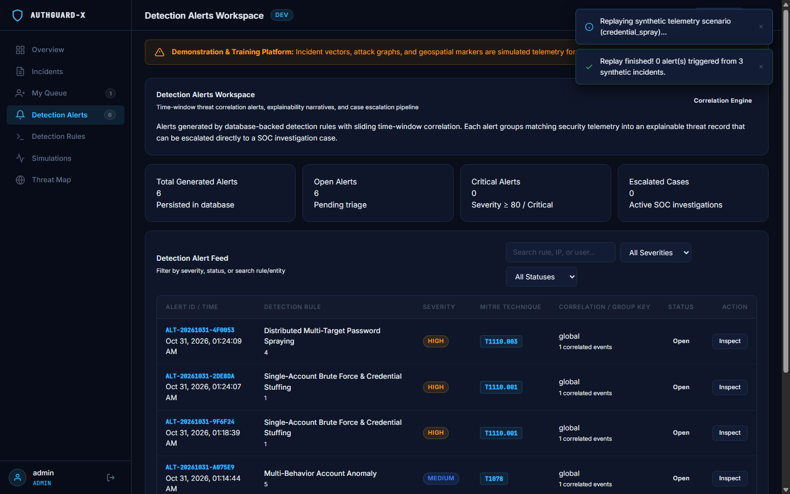 | 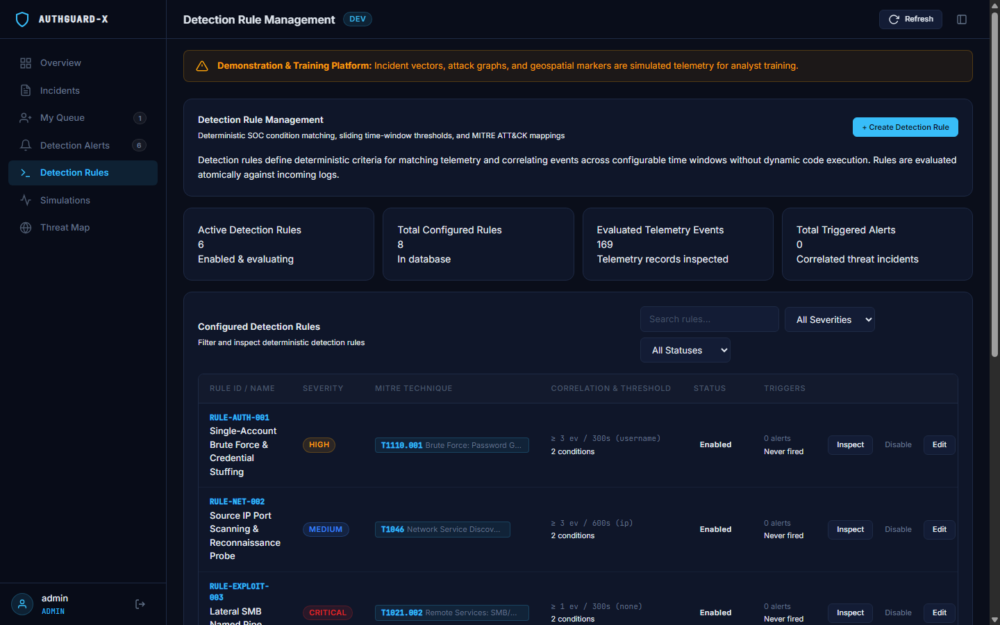 |
| *High-fidelity correlated alerts, sliding-window grouping & 1-click case escalation* | *Enterprise rule catalog, MITRE ATT&CK techniques & safe condition builder* |

| 11. Correlated Alert Detail & Explainability | 12. Mobile Responsive Alerts Layout |
|:---:|:---:|
| 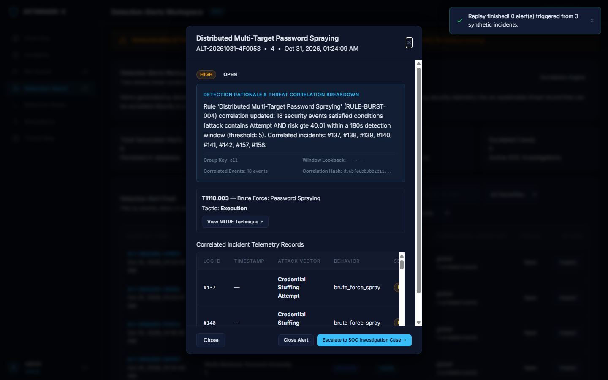 | 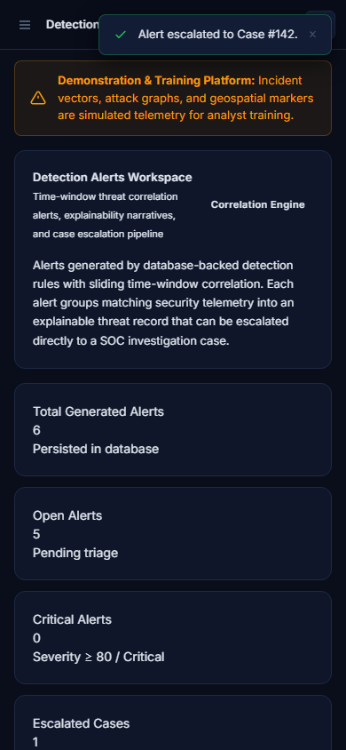 |
| *Dynamic explainability narrative, ATT&CK links & correlated incident logs* | *Flawless responsive rendering on 390px, 768px, 1440px, and 1920px viewports* |

<div align="center">
  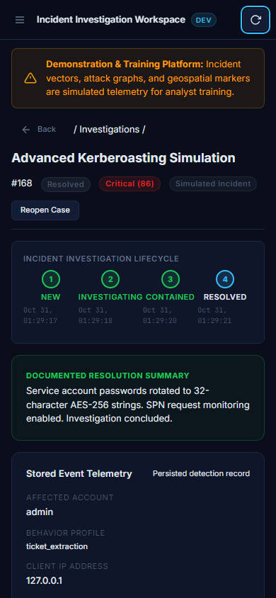
  <p><em>Responsive mobile analyst investigation layout with zero horizontal overflow</em></p>
</div>

---

## Cybersecurity & SOC Use Cases

1. **Structured Case Investigation Training**: Transition junior and tier-2 analysts from basic alert closing to a rigorous 4-stage lifecycle state machine (**New → Investigating → Contained → Resolved**).
2. **Analyst Ownership & Queue Triage**: Model multi-analyst SOC shift workflows where analysts claim unassigned incidents, manage personal active queues, and collaborate with role-based isolation.
3. **Detection Engineering & Custom Rules**: Author and tune enterprise detection rules with schema-constrained conditions (`equals`, `contains`, `greater_than`, `in`, `regex_safe`), configurable severity, and time-window correlation thresholds without insecure code execution (`eval`).
4. **Sliding-Window Threat Correlation Engine**: Correlate high-velocity multi-event attacks (e.g. distributed brute force across target usernames, IP reconnaissance bursts) using sliding time windows and deterministic SHA-256 idempotency hashing to prevent duplicate alert storms.
5. **MITRE ATT&CK Mapping & Explainability**: Align detections directly to official ATT&CK tactics, techniques, and sub-techniques (T1110.001, T1046, T1190, T1078, T1059, T1558.003) with direct HTTPS links and dynamic narrative summaries.
6. **Alert Escalation to Investigation Cases**: One-click escalation transition linking correlated alerts directly to incident response investigation cases with full provenance and audit logging.
7. **Forensic Findings & Evidence Collection**: Capture timestamped triage observations, hypothesis testing notes, and attach structured evidence pointers (IOC hashes, network PCAP references, log excerpts) with URL scheme safety validation (strictly rejecting unsafe URI schemes like `javascript:`, `data:`, `file:`).
8. **Accountability & Transactional Auditing**: Maintain an append-only audit trail logging every state transition, analyst reassignment, rule modification, and containment timestamp with server-derived actor identity, plus a persistent system administrative audit log retained across incident purges.
9. **Attack Vector Simulation & Synthetic Replay**: Generate synthetic credential-stuffing, lateral traversal, and Kerberoasting telemetry to evaluate detection posture and test analyst workflows with server-enforced provenance.
10. **Defensive Hardening Reference**: Production-grade Flask architecture featuring bcrypt password hashing (12 rounds), signed session cookies, CSRF protection, optimistic concurrency locking (`version`), RBAC middleware, and XSS sanitization.

---

## Architecture Overview

```
                      +---------------------------------------+
                      |       Web Browser (Frontend)         |
                      |  - Modular Vanilla JS (ES6+)          |
                      |  - Design Tokens & 8px Spacing Grid   |
                      |  - Detection Alerts & Rules Workspaces|
                      |  - Investigation Lifecycle Stepper    |
                      |  - Real-time Work Queue & Metrics     |
                      |  - XSS-Safe DOM Sanitization          |
                      +-------------------+-------------------+
                                          |
                        HTTP / JSON (REST)| Session Cookies + CSRF Token
                        SameSite=Lax      | HttpOnly + X-CSRFToken
                                          v
                      +-------------------+-------------------+
                      |      Flask Application Server         |
                      |  - Session Auth & RBAC Middleware     |
                      |  - Rule Engine (Safe Non-Eval AST)    |
                      |  - Threat Correlation Engine (Windows)|
                      |  - Lifecycle State Machine Engine     |
                      |  - Flask-WTF CSRF Token Enforcement   |
                      |  - Rate Limiting (Flask-Limiter)      |
                      |  - Evidence Reference URL Validation  |
                      |  - Transactional Audit Logger         |
                      +-------------------+-------------------+
                                          |
                                          v
                      +-------------------+-------------------+
                      |       Persistence Engine (SQLite)     |
                      |  - `users`: bcrypt hashed credentials |
                      |  - `logs`: Incident telemetry records |
                      |  - `cases`: Lifecycle status & owners |
                      |  - `detection_rules`: Authored rules  |
                      |  - `detection_alerts`: Correlated alts|
                      |  - `rule_audit_log`: Rule change log  |
                      |  - `incident_notes`: Forensic notes   |
                      |  - `incident_evidence`: Metadata/IOCs |
                      |  - `incident_audit_log`: Audit trail  |
                      +---------------------------------------+
```

---

## Investigation Lifecycle State Machine

AuthGuard-X implements an enterprise SOC incident response lifecycle:

```
    [ New ] --------( Start Investigation / Claim )--------> [ Investigating ]
                                                                   |
                                                                   | ( Mark Contained )
                                                                   v
    [ Resolved ] <-------( Resolve + Document Summary )------ [ Contained ]
         |
         +----------( Reopen + Mandatory Justification )-----> [ Investigating ]
```

### State Machine Rules:
- **New → Investigating**: Permitted for assigned analyst or when claiming unassigned incident. Sets `investigation_started_at`.
- **Investigating → Contained**: Indicates isolation of affected host, credential rotation, or firewall block. Sets `contained_at`.
- **Contained → Resolved**: Requires a mandatory, non-trivial resolution summary (minimum 5 characters) explaining root cause and remediation. Sets `resolved_at` and synchronizes legacy `logs.resolved = 1`.
- **Investigating → Resolved**: Direct resolution permitted with mandatory resolution summary.
- **Resolved → Investigating (Reopening)**: Requires mandatory justification. Resets `logs.resolved = 0` and increments `reopen_count`.
- **Invalid Transitions**: Any backward jump without reopening (e.g., `Resolved → Contained`, `Contained → New`) is strictly rejected with `400 Bad Request`.

---

## Role-Based Access Control (RBAC) Matrix

| Endpoint / Operation | Analyst | Administrator | Unauthenticated |
|---|:---:|:---:|:---:|
| `GET /api/incidents` (Search/Filter/List) | Allowed | Allowed | 401 Unauthorized |
| `GET /api/incidents/<id>/case` (Details) | Allowed | Allowed | 401 Unauthorized |
| `PATCH /api/incidents/<id>/case` (Lifecycle) | Assigned Only / Auto-Claim | Allowed Any | 401 Unauthorized |
| `POST /api/incidents/<id>/resolve` (Legacy & Unified) | Assigned Only | Allowed Any | 401 Unauthorized |
| `POST /api/incidents/<id>/assign` (Self-Claim) | Unassigned Only | Allowed Any | 401 Unauthorized |
| `POST /api/incidents/<id>/assign` (Reassign Others) | 403 Forbidden | Allowed | 401 Unauthorized |
| `POST /api/incidents/<id>/notes` (Add Note) | Assigned / Auto-Claim | Allowed Any | 401 Unauthorized |
| `POST /api/incidents/<id>/evidence` (Add IOC) | Assigned / Auto-Claim | Allowed Any | 401 Unauthorized |
| `GET /api/cases/my-queue` (Personal Queue) | Personal Cases | Personal Cases | 401 Unauthorized |
| `GET /api/cases/unassigned` (Unclaimed) | Allowed | Allowed | 401 Unauthorized |
| `POST /api/incidents/clear` (Purge Protection) | 403 Forbidden | Requires `force_purge_investigations` + `purge_reason` | 401 Unauthorized |
| `POST /api/users/create` (Create Analyst) | 403 Forbidden | Allowed | 401 Unauthorized |
| `GET /api/detection/rules` (View Rules) | Allowed | Allowed | 401 Unauthorized |
| `POST /api/detection/rules` (Create Rule) | 403 Forbidden | Allowed | 401 Unauthorized |
| `PATCH /api/detection/rules/<id>` (Update Rule) | 403 Forbidden | Allowed | 401 Unauthorized |
| `POST /api/detection/rules/<id>/toggle` (Toggle) | 403 Forbidden | Allowed | 401 Unauthorized |
| `DELETE /api/detection/rules/<id>` (Delete Rule)| 403 Forbidden | Allowed | 401 Unauthorized |
| `GET /api/detection/alerts` (List Alerts) | Allowed | Allowed | 401 Unauthorized |
| `POST /api/detection/alerts/<id>/escalate` | Allowed | Allowed | 401 Unauthorized |
| `POST /api/detection/alerts/<id>/close` | Allowed | Allowed | 401 Unauthorized |
| `POST /api/detection/replay` (Threat Replay) | Allowed | Allowed | 401 Unauthorized |

---

## Detection Engineering & MITRE ATT&CK Matrix (Sprint 3)

AuthGuard-X features a database-backed detection rule engine and a sliding time-window correlation engine. Detection rules evaluate incoming security telemetry against schema-constrained operators without dynamic code evaluation (`eval`), and group multi-event sequences into high-fidelity alerts.

### Default Detection Rules & MITRE Mappings

| Rule ID | Rule Name | MITRE ATT&CK ID | ATT&CK Technique | Window / Threshold | Severity |
|---|---|:---:|---|:---:|:---:|
| `RULE-AUTH-001` | Single-Account Brute Force & Credential Stuffing | [T1110.001](https://attack.mitre.org/techniques/T1110/001/) | Brute Force: Password Guessing | 60s / 3 per target username | Critical |
| `RULE-NET-002` | Port Scanning Reconnaissance Probe | [T1046](https://attack.mitre.org/techniques/T1046/) | Network Service Discovery | 45s / 3 per source IP (scan behavior + risk >= 50) | High |
| `RULE-EXPLOIT-003` | Lateral SMB Named Pipe Traversal | [T1021.002](https://attack.mitre.org/techniques/T1021/002/) | Remote Services: SMB/Windows Admin Shares | 0s / 1 event (lateral attribute + risk >= 75) | Critical |
| `RULE-BURST-004` | Multi-Target Password Spraying | [T1110.003](https://attack.mitre.org/techniques/T1110/003/) | Brute Force: Password Spraying | 120s / 5 total events | High |
| `RULE-BEHAV-005` | Multi-Behavior Anomaly Chain | [T1078](https://attack.mitre.org/techniques/T1078/) | Valid Accounts | 180s / 2 distinct non-empty behaviors | Medium |
| `RULE-KERB-006` | Active Directory Kerberoasting | [T1558.003](https://attack.mitre.org/techniques/T1558/003/) | Steal or Forge Kerberos Tickets: Kerberoasting | 0s / 1 event (SPN extraction) | High |

### Safe Rule Condition Evaluation Engine
- **Allowed Fields**: `attack`, `username`, `ip_address`, `severity`, `risk_score`, `behavior`.
- **Allowed Operators**: `eq`, `neq`, `contains`, `not_contains`, `gte`, `lte`, `gt`, `lt`, `in`, `not_empty` (with backwards-compatible aliases `equals`, `greater_than`, `less_than`, `regex_safe`).
- **Zero Eval**: All comparisons execute strictly through typed Python AST comparisons with regex timeouts, rejecting any arbitrary execution attempts.
- **Sliding-Window Correlation & State Updating**: Aggregates incidents within a sliding time window (e.g. 60 seconds) grouped by `target_username`, `source_ip`, or globally. When subsequent matching events arrive within the active window, the alert state is updated (`matched_count`, `last_event_time`, `matched_incident_ids_json`, `explanation`) rather than spawning duplicate alert storms.
- **Idempotency Protection**: Deterministic SHA-256 hashing across `rule_id`, `group_key`, and the correlation window prevents duplicate alert creation for identical event sequences.
- **Safe Rule Archival & Data Retention**: Detection rules support soft-deletion (`status = 'archived'`). Archived rules are excluded from live pipeline evaluation while preserving historical alerts, execution records, audit logs, and case linkages. Foreign key relationships enforce `ON DELETE RESTRICT` to guarantee audit trail integrity.
- **One-Click Case Escalation**: Analysts can escalate any correlated alert into a formal incident response case with bidirectional linking, verified membership checks, cross-analyst ownership validation (403 Forbidden for unassigned analysts), duplicate escalation prevention (409 Conflict), and atomic audit logging.

---

## Technology Stack

- **Backend Framework**: Python 3.11+ / Flask 3.1
- **Security & Cryptography**: `bcrypt` (adaptive blowfish hashing, 12 rounds), `secrets` (CSPRNG session keys)
- **CSRF & Form Defense**: `Flask-WTF` CSRF protection with `/api/auth/csrf-token` endpoint
- **Session & Origin Management**: Flask Session (`HttpOnly`, `SameSite=Lax`, `Secure` in production), `Flask-Cors` (strict whitelist)
- **Traffic Protection**: `Flask-Limiter` (IP-based endpoint rate throttling)
- **Frontend Architecture**: Modular Vanilla JavaScript (ES6+), design tokens (`tokens.css`), responsive layout (`layout.css`), accessible components (`components.css`), Chart.js
- **Database Engine**: SQLite3 with strict foreign keys (`PRAGMA foreign_keys = ON`), indexed lookups, and idempotent migrations
- **Automated QA**: Pytest suite (116 tests across 4 suites) and headless Chrome CDP browser automation (24 real assertions)

---

## Quickstart & Execution Guide

### Prerequisites
- Python 3.11 or later installed.
- Git.

### 1. Clone & Set Up Environment

```powershell
# Clone the repository
git clone https://github.com/Mannan55/AuthGuard-X.git
cd AuthGuard-X

# Create and activate a virtual environment (optional but recommended)
python -m venv venv
.\venv\Scripts\Activate.ps1    # On Windows
# source venv/bin/activate     # On Linux / macOS

# Install dependencies
pip install -r backend/requirements.txt
```

### 2. Configure Environment Variables

```powershell
# Copy the provided environment template
cp .env.example .env    # On Linux / macOS
copy .env.example .env  # On Windows
```

Key environment configuration variables:

```ini
AUTHGUARD_ENV=development
HOST=127.0.0.1
PORT=5000
SECRET_KEY=your-cryptographic-secret-key-32bytes
DEMO_MODE=true
SEED_DEMO_USER=true
DEMO_ADMIN_USER=admin
DEMO_ADMIN_PASSWORD=DemoAdminPassword2026!
CORS_ALLOWED_ORIGINS=http://127.0.0.1:5000,http://localhost:5000
ENABLE_EXTERNAL_GEOIP=false
```

### 3. Run the Application

```powershell
python backend/app.py
```

Open your browser to:
**[http://127.0.0.1:5000](http://127.0.0.1:5000)**

Default development accounts:
- **Administrator**: `admin` / `DemoAdminPassword2026!`
- **Tier-1 Analyst**: `analyst_john` / `AnalystJohn2026!`
- **Tier-2 Analyst**: `analyst_jane` / `AnalystJane2026!`

---

## Automated Verification & Testing

The project includes two comprehensive layers of automated verification:

```powershell
# 1. Run the complete Pytest suite (116 tests)
pytest tests -v

# 2. Run real-browser visual and functional verification (24 assertions + screenshots)
python scripts/capture_evidence.py
```

### Test Suite Distribution (116 Tests Total)
- **Phase 1 Baseline** (`tests/test_auth_guard.py` — 15 tests): Health check, login validation, session state, unauthenticated access blocking, and persistence across restarts.
- **Sprint 1 Professional UI & Hardening** (`tests/test_sprint1.py` — 54 tests): CSRF validation, simulation provenance enforcement, server-derived metrics, pagination envelopes, search/filter/sort allowlists, detail endpoints, and XSS resistance.
- **Sprint 2 Advanced SOC Investigation & Security Corrections** (`tests/test_sprint2.py` — 29 tests): Idempotent database migrations, automatic case creation, 4-stage lifecycle state machine, reopening workflow with incrementing `reopen_count`, mandatory resolution summary, strict case ownership enforcement (Analyst A cannot resolve Analyst B's cases), auto-claim policy on unassigned cases, strengthened optimistic concurrency locking with strict boolean and malformed value rejection (`version` validation, 428 Precondition Required for missing, 400 for malformed/booleans, 409 for conflict), multi-client simultaneous race safety, URI scheme safety validation for evidence, administrative log purge protection with mandatory reason and persistent `system_audit_log`, personal queue isolation, single Investigate handler deduplication, and CSRF enforcement on case APIs.
- **Sprint 3 Detection Engineering & Threat Correlation** (`tests/test_sprint3.py` — 18 tests): Default rule seeding with verified MITRE ATT&CK techniques, schema-constrained condition validation rejecting `eval()` and injection payloads, rule CRUD with RBAC enforcement and optimistic concurrency locking, sliding time-window threat correlation with state updating across IP and username grouping, SHA-256 idempotency hashing preventing duplicate alerts, safe rule archival retaining historical alerts, execution records, audit logs, and case linkages, cross-analyst alert escalation ownership validation (403 for unauthorized analysts, 409 for duplicate escalation), alert closure, synthetic threat replay scenarios, and real telemetry analytics.

---

## License

Distributed under the MIT License. See `LICENSE` for more information.
