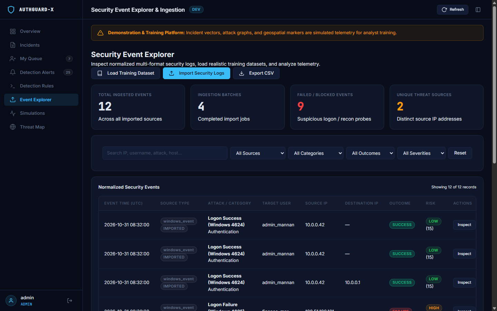
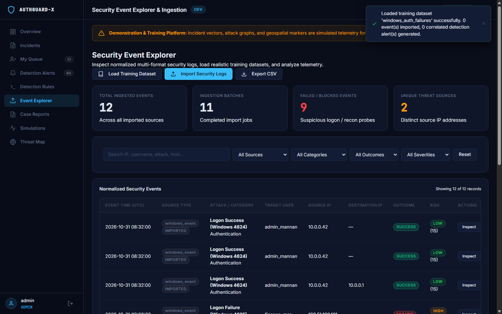
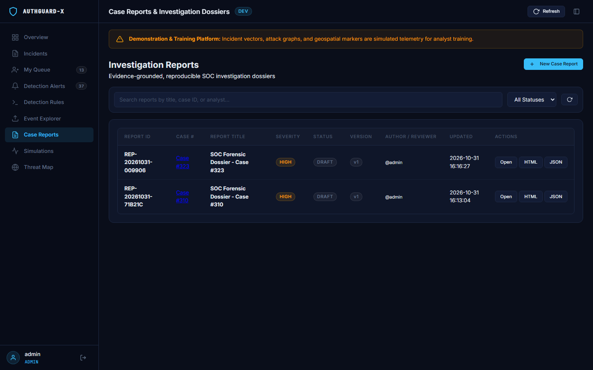
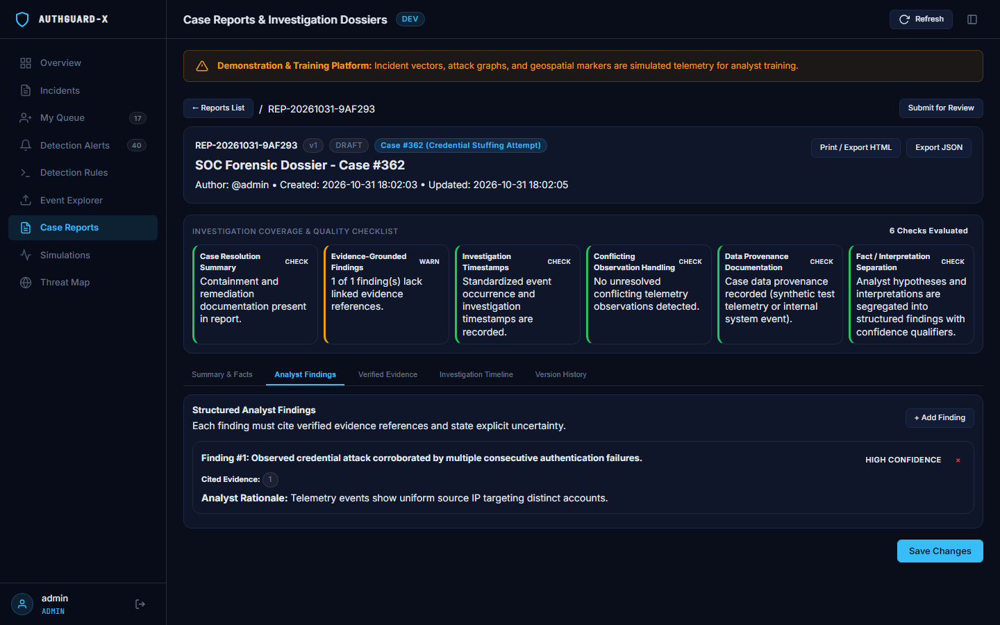
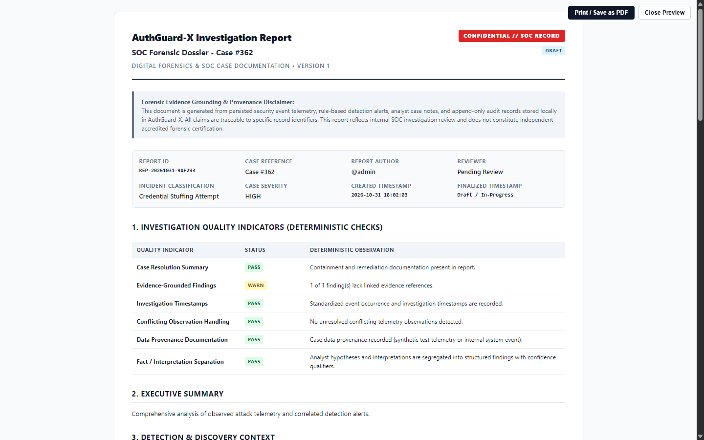

# AuthGuard-X — Security Operations Center (SOC) Simulation, Ingestion & Incident Investigation Platform

[](https://github.com/Mannan55/AuthGuard-X/actions/workflows/ci.yml)
[](https://www.python.org/downloads/)
[](https://flask.palletsprojects.com/)
[](https://www.sqlite.org/)
[](LICENSE)
[](https://github.com/Mannan55/AuthGuard-X/releases/tag/v1.0.0)

AuthGuard-X is a professional, local-first Security Operations Center (SOC) demonstration, training, detection engineering, and incident response platform. Designed for cybersecurity analysts, educators, and blue teams, it models an enterprise identity and network security monitoring environment that ingests multi-format security logs, runs sliding-window detection rules, correlates threats against MITRE ATT&CK techniques, manages investigations through a 4-stage lifecycle state machine, and generates evidence-grounded investigation reports.

> **Forensic Integrity & Provenance Disclaimer:** All attack vectors, simulated incident streams, and geographic origins are generated locally with server-enforced provenance (`is_simulated = 1`). Imported log files are hashed using SHA-256 upon ingestion (`exact_source_bytes`) to ensure chain-of-custody. AuthGuard-X does not execute live exploits or rely on unverified external threat feeds.

---

## Visual Demonstration & SOC Workspaces

| 1. Authentication Portal | 2. Operational SOC Overview |
|:---:|:---:|
|  |  |
| *Session-based login with dev credential guidance* | *Live KPI cards, dynamic health score & threat timeline* |

| 3. Advanced Incident Management Table | 4. Incident Detail Triage Modal |
|:---:|:---:|
|  |  |
| *Search by ID/text, severity/status/source filters & pagination* | *Audit metadata, one-click remediation & investigation routing* |

| 5. Attack Simulation Lab | 6. Analyst Incident Work Queue |
|:---:|:---:|
|  |  |
| *Controlled synthetic vector injection with city/risk targeting* | *Queue isolation, active triage filters & real-time KPI metrics* |

| 7. Investigation Workspace & Lifecycle Stepper | 8. Evidence Metadata & Audit Timeline |
|:---:|:---:|
|  |  |
| *State machine progression (`New` → `Investigating` → `Contained` → `Resolved`)* | *Sanitized notes, IOC/pcap evidence pointers & append-only activity audit trail* |

| 9. Detection Alerts Feed & Threat Correlation | 10. Detection Rules Catalog & MITRE Mapping |
|:---:|:---:|
|  |  |
| *High-fidelity correlated alerts, sliding-window grouping & 1-click case escalation* | *Enterprise rule catalog, MITRE ATT&CK techniques & safe condition builder* |

| 11. Security Event Explorer | 12. Normalized Event Detail Modal |
|:---:|:---:|
|  |  |
| *Searchable multi-format telemetry feed with batch provenance* | *Normalized forensic fields, UTC timestamps & SHA-256 byte hashes* |

| 13. Case Reports Workspace | 14. Evidence-Grounded Report Builder |
|:---:|:---:|
|  |  |
| *Investigation reports with status filters & version snapshots* | *Auto-populated grounded facts, findings, and timeline* |

| 15. Deterministic Quality Indicators (QC) | 16. Standalone Printable Report Export |
|:---:|:---:|
|  |  |
| *6 automated indicators ensuring forensic completeness* | *Clean @media print layout with confidentiality disclaimers* |

---

## Core Feature Overview (Sprints 1–5)

### 1. Ingestion & Preprocessing (Sprint 4)
- **Multi-Format Parsers**: Native parsing for Windows Event ID 4625 (Logon Failures), Linux `/var/log/auth.log` (sshd authentication), RFC 5424 Syslog, Palo Alto Firewall traffic, and newline-delimited JSON.
- **Forensic Chain-of-Custody**: SHA-256 cryptographic hashing of exact raw input bytes (`exact_source_bytes`) to guarantee evidentiary traceability.
- **Strict Timestamp Normalization**: UTC normalization preserving source timezone offsets, handling epoch seconds, epoch milliseconds, and malformed dates without synthetic invention.

### 2. Detection Engineering & Threat Correlation (Sprint 3)
- **Safe AST Rule Evaluation**: Schema-constrained rule conditions (`equals`, `contains`, `greater_than`, `in`, `regex_safe`) evaluated in Python memory without unsafe `eval()` or shell execution.
- **Sliding-Window Correlation**: Configurable time windows (e.g., 60s for Credential Stuffing, 45s for Network Recon, 120s for Attack Bursts) aggregating multi-event patterns.
- **Multi-Target Password Spray Enforcement**: Strictly requires distinct target usernames (`RULE-AUTH-003`), eliminating single-account false positives.
- **MITRE ATT&CK Framework Mapping**: Direct alignment to techniques including T1110.001 (Password Spraying), T1046 (Network Service Discovery), T1190 (Exploit Public-Facing Application), and T1078 (Valid Accounts).

### 3. Investigation Lifecycle & Case Management (Sprint 2)
- **4-Stage Formal State Machine**: Progression from **New** $\rightarrow$ **Investigating** $\rightarrow$ **Contained** $\rightarrow$ **Resolved** with enforced prerequisite checks.
- **Analyst Work Queues**: Claiming, personal active queue views, and role-based access control (`admin` vs `analyst`).
- **Evidence Reference Validation**: Links to external evidence (PCAP files, IOC hashes) are validated against URL scheme whitelists (`http://`, `https://`), strictly blocking unsafe protocols (`javascript:`, `data:`, `file:`).
- **Append-Only Auditing**: Full audit trail recording analyst reassignments, status transitions, containment timestamps, and note modifications.

### 4. Evidence-Grounded SOC Reporting (Sprint 5)
- **Zero Generative Hallucination**: Report claims are derived strictly from persisted security events, correlated detection alerts, case action logs, and verified evidence links.
- **6 Deterministic Quality Indicators (QC)**:
  1. Incident Classification Alignment
  2. Telemetry Occurrence vs Recorded Latency
  3. Correlated Detection Rule Coverage
  4. Analyst Hypothesis & Finding Documentation
  5. Evidence Reference Traceability
  6. Containment Milestone Validation
- **Immutable Version Snapshots**: Finalized reports are frozen in `report_versions` as full JSON snapshots. Re-exporting earlier versions (`?version=1`) guarantees 100% byte-for-byte reproducibility even after live cases mutate.
- **Centralized Report Authorization**: Server-enforced permissions governing report viewing, editing, lifecycle state transitions, revisions, and exports based on case ownership and admin roles.

---

## Technology Stack

- **Backend**: Python 3.11+, Flask 3.1, Flask-WTF (CSRF), Flask-Limiter (Rate Limiting), Werkzeug.
- **Database**: SQLite 3 with Write-Ahead Logging (WAL) and foreign key integrity.
- **Cryptography**: `bcrypt` (12 rounds) for passwords, `hashlib.sha256` for forensic source integrity.
- **Frontend**: Vanilla ES6+ JavaScript (zero external CDN or node_modules dependencies), custom CSS design tokens (8px grid), native SVG icons.
- **Testing**: `pytest`, `pytest-cov`, and automated Chromium CDP browser verification.
- **CI/CD**: GitHub Actions matrix across Python 3.11, 3.12, 3.13 on Ubuntu and Windows.

---

## Installation & Setup

### Prerequisites
- Python 3.11 or higher installed.
- Git.

### 1. Clone Repository
```bash
git clone https://github.com/Mannan55/AuthGuard-X.git
cd AuthGuard-X
```

### 2. Create and Activate Virtual Environment

**Windows (PowerShell):**
```powershell
python -m venv venv
.\venv\Scripts\Activate.ps1
```

**Linux / macOS:**
```bash
python3 -m venv venv
source venv/bin/activate
```

### 3. Install Dependencies
```bash
pip install --upgrade pip
pip install -r backend/requirements.txt
```

### 4. Run Application
```bash
python backend/app.py
```
Open your browser and navigate to:
```
http://127.0.0.1:5000/
```

---

## Development Demo Credentials

AuthGuard-X includes development demo accounts for local evaluation and testing:

| Role | Username | Password | Permissions |
| :--- | :--- | :--- | :--- |
| **Administrator** | `admin` *(or `testadmin`)* | `admin123` *(or `AdminPassword2026!`)* | Full access across all cases, rules, ingestion batches, and reports. |
| **SOC Analyst** | `analyst_john` | `AnalystPassword2026!` | Access to assigned cases, evidence linking, and personal reports. |
| **SOC Analyst** | `analyst_jane` | `AnalystPassword2026!` | Isolated queue for multi-analyst access testing. |

> [!WARNING]
> Demo accounts are provisioned exclusively when running in development mode (`DEMO_MODE=true`). For production deployments, set `AUTHGUARD_ENV=production` and `DEMO_MODE=false`.

---

## Running the Automated Test Suite

### Full Pytest Suite (161 Tests)
```bash
pytest tests -v
```

### Real-Browser Chromium CDP Verification (34 Assertions)
```bash
python scripts/capture_evidence.py
```

All 34 browser assertions—including layout verification on 390px, 768px, 1440px, and 1920px viewports, modal interactions, simulation runs, and standalone HTML export rendering—will execute and output fresh screenshots into `docs/screenshots/`.

---

## Documentation Quick Links

- [Technical Architecture Specification (`docs/ARCHITECTURE.md`)](docs/ARCHITECTURE.md)
- [5-Minute Analyst Demo Guide (`docs/DEMO_GUIDE.md`)](docs/DEMO_GUIDE.md)
- [Presentation Outline (8–10 Slides) (`docs/PRESENTATION_OUTLINE.md`)](docs/PRESENTATION_OUTLINE.md)
- [v1.0.0 Release Notes (`docs/RELEASE_NOTES_v1.0.md`)](docs/RELEASE_NOTES_v1.0.md)

---

## License

This project is licensed under the MIT License — see the [LICENSE](LICENSE) file for details.
