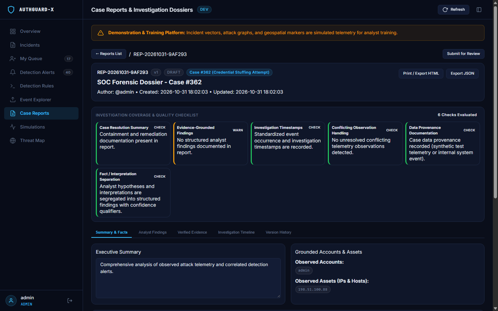

# AuthGuard-X

**A local-first SOC training and incident investigation platform.**

[](https://github.com/Mannan55/AuthGuard-X/actions/workflows/ci.yml)
[](https://www.python.org/downloads/)
[](LICENSE)
[](https://github.com/Mannan55/AuthGuard-X/tree/v3)

## What does it do?

AuthGuard-X is a practice control room for cybersecurity investigations. Generate a safe, synthetic attack scenario or import supported security logs, inspect detection alerts, investigate the associated incidents, and prepare evidence-linked reports.

For example: simulate suspicious login activity, inspect the stored records and any alerts triggered by enabled rules, document your findings, then export an investigation report.

**It creates training records; it does not attack remote computers.** Marking a case contained or resolved documents an investigation action; it does not itself block an IP address or disable an account.

## Start with one workflow

1. Sign in using a local development account.
2. Open **Simulations** and generate a scenario.
3. Inspect the resulting **Incidents** and **Detection Alerts**, where rule conditions are met.
4. Open an investigation, add notes and evidence, and document its status.
5. Use **Case Reports** to review findings and export a report.

For a walkthrough using imported logs, see the [Demo Guide](docs/DEMO_GUIDE.md).

| Role | Purpose |
| --- | --- |
| SOC analyst | Review alerts, work assigned investigations, document evidence, and prepare reports. |
| Administrator | Perform privileged administration and manage the training environment. |

Both roles share the workspace and sign-in page. Server permissions determine which operations are available. Simulation controls support training; they are not a separate customer-facing service.

## Workspace previews

These screenshots show existing workspaces from earlier captures; individual details may differ from the current source.

| SOC overview | Investigation workspace |
| --- | --- |
|  |  |

| Detection alerts | Case reports |
| --- | --- |
|  |  |

The main SOC dashboard and terminal-style simulation presentation serve different parts of the training experience. The geographic simulation map is not an external live attack feed.

## Capabilities

- **Training scenarios:** locally generated synthetic incidents with provenance labels.
- **Log ingestion:** supported Windows failed-login records, Linux SSH authentication logs, RFC 5424 syslog, Palo Alto traffic logs, and newline-delimited JSON. See the demo guide for sample inputs.
- **Detection engineering:** configurable rule conditions, time-window correlation, and MITRE ATT&CK references. Technique mappings provide classification context, not proof that an attack occurred.
- **Incident investigation:** analyst queues, assignment, notes, evidence references, and the New → Investigating → Contained → Resolved lifecycle.
- **Case reporting:** structured findings, linked evidence, deterministic quality checks, review/finalization, stored version snapshots, and HTML/JSON export. Printable HTML supports browser Print / Save as PDF; do not confuse that workflow with a native PDF generator.
- **Security controls:** session authentication, bcrypt password hashing, CSRF protection, rate limiting, role checks, and version-conflict handling. Their presence does not establish production readiness or independent security certification.

## Architecture and stack

Security records → SQLite storage → detection and correlation → investigation cases → reports.

| Layer | Technology |
| --- | --- |
| Backend | Python, Flask, Flask-WTF, Flask-Limiter, Flask-Cors |
| Storage | SQLite |
| Frontend | HTML, CSS, vanilla JavaScript, SVG assets |
| External browser resources | Chart.js and Google Fonts loaded from CDNs |
| Validation | Pytest and a separate Chromium CDP capture script |
| CI | Python 3.11, 3.12, and 3.13 on Ubuntu and Windows |

Application records are stored locally. CDN resources may require internet access; local-first does not mean that every browser asset is bundled for offline use.

## Installation

Requires Git and Python 3.11 or later.

```bash
git clone https://github.com/Mannan55/AuthGuard-X.git
cd AuthGuard-X
```

Create and activate a virtual environment using the commands for your terminal.

**Windows Command Prompt:**

```bat
python -m venv venv
venv\Scripts\activate.bat
```

**Windows PowerShell:**

```powershell
python -m venv venv
.\venv\Scripts\Activate.ps1
```

**Linux / macOS:**

```bash
python3 -m venv venv
source venv/bin/activate
```

Install dependencies and start the application:

```bash
python -m pip install -r backend/requirements.txt
python backend/app.py
```

Open **http://127.0.0.1:5000/**. See [.env.example](.env.example) for configuration options.

### Local development accounts

Default seeded accounts for development mode:

| Role | Username | Default password |
| --- | --- | --- |
| Administrator | `admin` | `DemoAdmin2026!` |
| Analyst | `analyst_john` | `AnalystPassword2026!` |
| Analyst | `analyst_jane` | `AnalystPassword2026!` |

The admin account can be configured with `DEMO_ADMIN_USER` and `DEMO_ADMIN_PASSWORD`. Existing admin accounts may retain an earlier password. The current development login also accepts legacy password aliases; keep demo mode limited to local training. `testadmin` is used by CI configuration, not the default installation username.

Demo seeding requires development mode with `DEMO_MODE=true` and `SEED_DEMO_USER=true`. Changing production environment flags alone is not a complete production deployment or hardening procedure.

## Evidence and limitations

- Synthetic incidents and map origins are training data. Imported records remain unverified input.
- SHA-256 hashes help identify content changes. They do not establish source authenticity or prove a forensic chain of custody. Exact source-byte hashes and normalized-payload hashes have different meanings.
- Reports distinguish recorded information from analyst conclusions. Finalization and checklist completion do not independently verify forensic accuracy.
- Stored report snapshots support historical versions. Validate version-specific export behavior for your use case rather than relying on an unconditional byte-for-byte guarantee.
- This is a demonstration and training project, not a replacement for a deployed enterprise SIEM, endpoint protection, or a response team.

## Verification

Run backend tests from the repository root:

```bash
python -m pytest tests -v
```

An earlier local validation in this project workflow reported **161 passed**. That is historical evidence, not a fresh result for every later commit. Check the [Actions page](https://github.com/Mannan55/AuthGuard-X/actions) for the run associated with the source revision you use.

The separate capture script documents browser workflows:

```bash
python scripts/capture_evidence.py
```

It imports `websocket` (provided by `websocket-client`) and currently looks for Chrome/Edge in Windows installation paths. It is not an environment-independent browser test runner; inspect its requirements before running it. Earlier reported browser assertion totals are not a claim that this documentation update reran them.

## Documentation and versions

- [Architecture](docs/ARCHITECTURE.md)
- [Demo Guide](docs/DEMO_GUIDE.md)
- [Presentation Outline](docs/PRESENTATION_OUTLINE.md)
- [v3 development notes](docs/RELEASE_NOTES_v3.0.md)
- [v1.0 release notes](docs/RELEASE_NOTES_v1.0.md)
- [Repository presentation settings](docs/REPOSITORY_PRESENTATION.md)

The repository has source tags including `v1.0.0`, `v1.0.0-original`, `v2`, and `v3`. A Git tag and a published GitHub Release are separate things. No published release was returned by GitHub's Releases API during this documentation review. The `v3` badge links to tagged source; current `main` may include later changes.

## License

[MIT License](LICENSE), copyright Mannan Shah.
