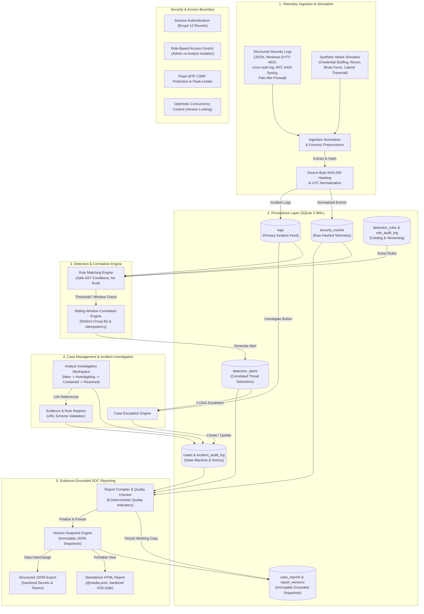

# AuthGuard-X — Technical Architecture Specification

AuthGuard-X is a local-first Security Operations Center (SOC) simulation, log ingestion, threat detection, investigation, and reporting platform designed for cybersecurity education, analyst training, and detection engineering.

---

## 1. High-Level System Architecture

---

## 2. Core Functional Subsystems

### 2.1 Ingestion & Normalization Subsystem
- **Multi-Format Parsers**: Dedicated parsers handle Windows Event ID 4625 (Logon Failures), Linux `/var/log/auth.log` (sshd failures), RFC 5424 syslog streams, Palo Alto / Cisco ASA firewall traffic logs, and newline-delimited JSON.
- **Forensic Source Hashing**: Ingested raw lines and batch files are hashed with SHA-256 (`exact_source_bytes`). Reconstructed normalized representations are explicitly flagged to prevent false forensic claims.
- **Strict Timestamp Handling**: Timezone-aware timestamps are normalized to ISO-8601 UTC. Ambiguous or missing timestamps are explicitly recorded as unverified or missing without silent substitution.

### 2.2 Detection Engineering & Correlation Engine
- **Safe Evaluation Pipeline**: Detection rules evaluate conditions (`equals`, `contains`, `greater_than`, `in`, `regex_safe`) against schema-constrained fields without `eval()`, `exec()`, or dynamic code execution.
- **Sliding-Window Aggregation**: Sliding windows (e.g., 60s for Credential Stuffing, 45s for Network Scans, 120s for Recon Bursts) aggregate matching events grouped by IP, username, or attack signature.
- **Distinct Target Enforcement**: Rules such as Password Spraying (`RULE-AUTH-003`) strictly require distinct target accounts, preventing repetitive single-target failures from misclassifying.
- **Deterministic Idempotency**: Alert deduplication hashes prevent alert storms and ensure duplicate events in the same time window do not spawn redundant alerts.
- **MITRE ATT&CK Mapping**: Rules align with official tactics and techniques (e.g., T1110.001 Brute Force, T1046 Network Service Scanning, T1078 Valid Accounts) with direct external references and explainability notes.

### 2.3 Investigation Lifecycle State Machine
- **Formal State Transitions**: Incidents and associated cases follow a strict 4-stage lifecycle:
  $$\text{New} \longrightarrow \text{Investigating} \longrightarrow \text{Contained} \longrightarrow \text{Resolved}$$
- **Analyst Queue Isolation**: Analysts can claim unassigned incidents, view personal active queues, and transition case status with optimistic concurrency safety (`version` checks preventing mid-air collisions).
- **Evidence Reference Validation**: Links to external evidence (PCAP files, IOC hashes, external wiki articles) are validated against strict URL scheme whitelists (`http://`, `https://`), blocking dangerous URI schemes (`javascript:`, `data:`, `file:`).
- **Append-Only Auditing**: Every assignment, status transition, containment milestone, and evidence modification generates an immutable audit record referencing the authenticated user and timestamp.

### 2.4 Evidence-Grounded SOC Reporting
- **Data Grounding Guarantee**: Reports are built exclusively from persisted security events, correlated detection alerts, case action logs, and verified evidence references. No generative hallucination or fictional evidence is introduced.
- **Deterministic Quality Indicators (QC)**: Six automatic checks evaluate report completeness:
  1. Incident Classification Alignment
  2. Telemetry Occurrence vs Recorded Latency
  3. Correlated Detection Rule Coverage
  4. Analyst Hypothesis & Finding Documentation
  5. Evidence Reference Traceability
  6. Containment Milestone Validation
- **Immutable Version Snapshots**: When a report is finalized, a full snapshot of findings, timeline, quality indicators, case facts, and disclaimers is frozen in `report_versions`. Re-exporting older versions (e.g., `?version=1`) reproduces the exact historical document even if the active case evolves or undergoes revision.
- **Centralized Authorization**: Centralized permissions enforce case ownership, report author rights, and administrative privileges across report reading, editing, status transitioning, revisions, and exports.

---

## 3. Threat Model & Security Controls

| Threat / Vulnerability | Defensive Control Implemented |
| :--- | :--- |
| **Credential Compromise** | Passwords hashed using bcrypt (12 rounds). Session cookies configured with `HttpOnly`, `SameSite=Lax`, and secret signing. |
| **Cross-Site Request Forgery (CSRF)** | Double-submit CSRF tokens verified via Flask-WTF on all mutating HTTP methods (`POST`, `PATCH`, `DELETE`). |
| **Stored & Reflected XSS** | Context-aware HTML escaping across all frontend templates and standalone printable exports. |
| **Code Injection in Detection Rules** | Condition evaluation performed via an in-memory dictionary matcher with safe operators; zero `eval()` or shell invocations. |
| **Race Conditions & Lost Updates** | Optimistic locking using version counters on cases (`cases.version`) and reports (`case_reports.version`), rejecting stale mutations with HTTP `409 Conflict`. |
| **Evidence Tampering & Provenance Spoofing** | Telemetry source byte SHA-256 hashing; distinct tracking of synthetic simulation (`is_simulated = 1`) vs imported logs (`is_simulated = 0`). |
| **Data Leakage in Exports** | Export serializers strip password hashes, secret keys, session tokens, and CSRF secrets from HTML and JSON payloads. |
